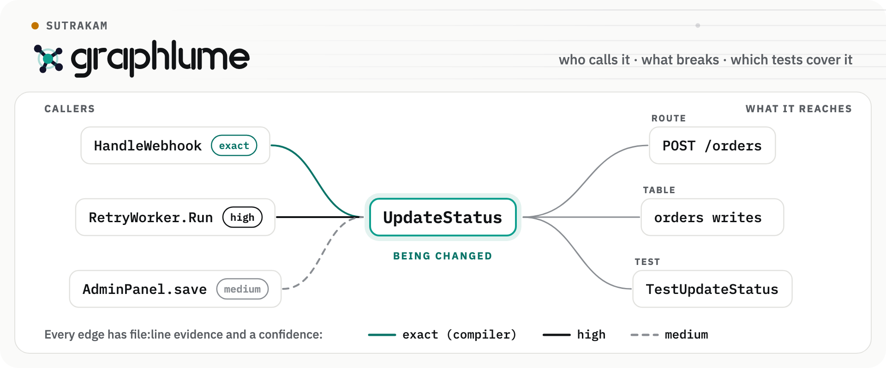
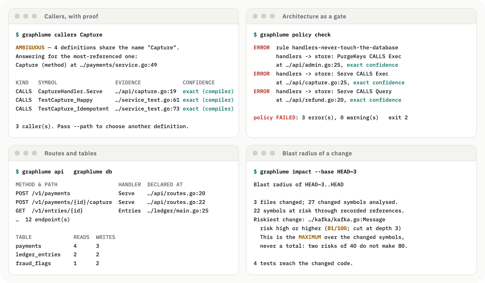
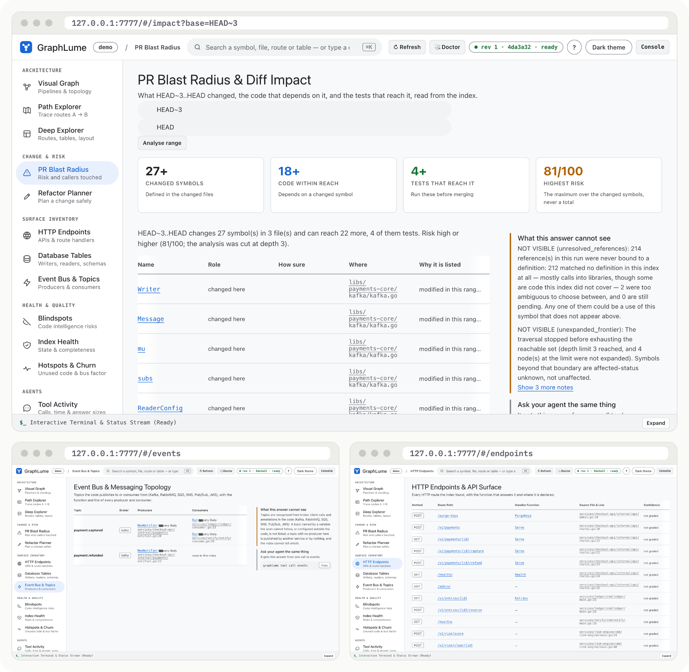
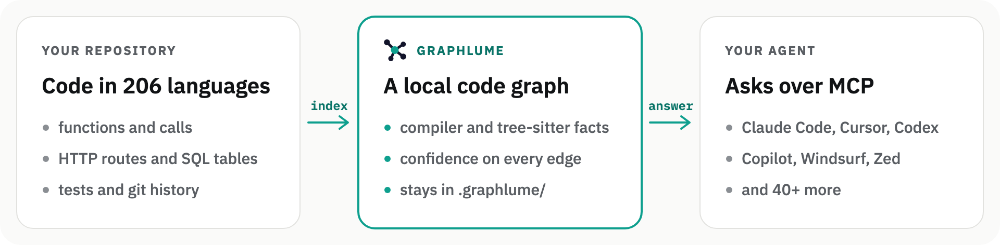
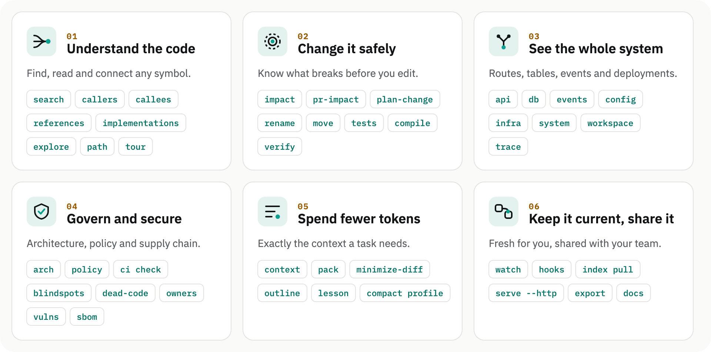
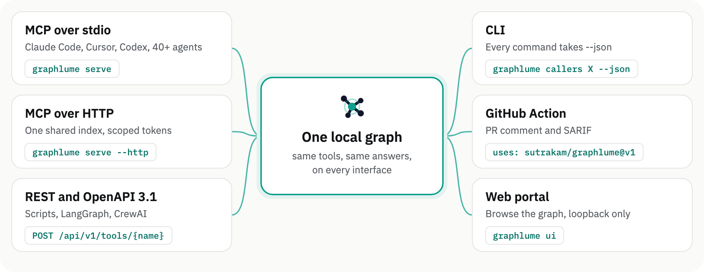
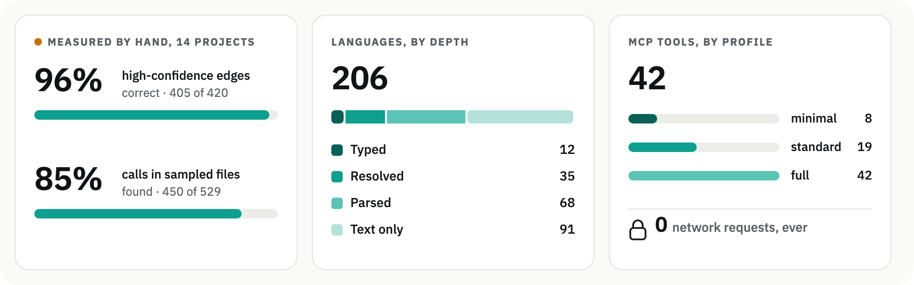
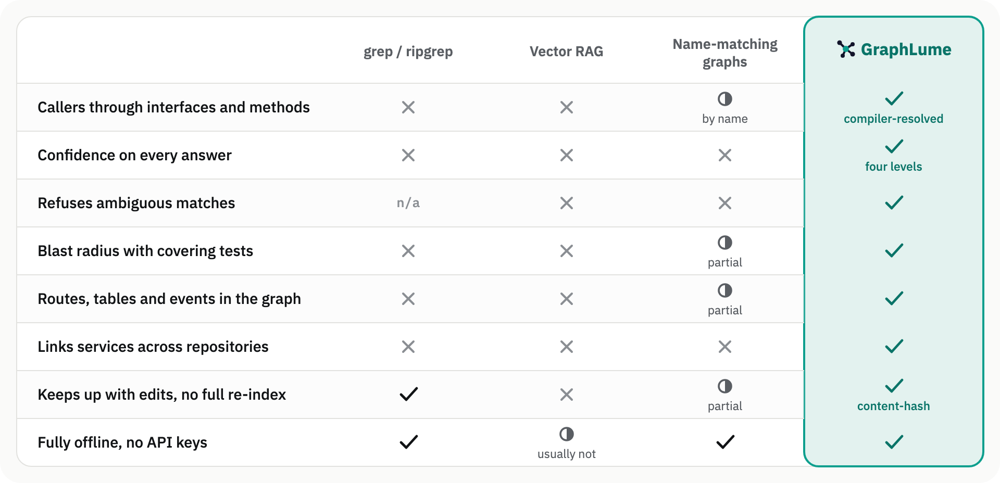

<div align="center">

<a id="top"></a>

<picture>
  <source media="(prefers-color-scheme: dark)" srcset="docs/assets/hero-dark.png">
  
</picture>

# GraphLume

**The local code knowledge graph and MCP server for AI coding agents.**

Callers, blast radius, routes, database tables and tests in one tool call,<br>
every answer backed by `file:line` evidence and a confidence level.

[](https://github.com/sutrakam/graphlume/actions/workflows/ci.yml)
[](https://github.com/sutrakam/graphlume/releases/latest)
[](https://pkg.go.dev/github.com/sutrakam/graphlume)
[](docs/reference/mcp-tools.md)
[](#languages)
[](LICENSE)

[Quickstart](#quickstart) · [User guide](docs/USER_GUIDE.md) · [See it](#see-it-in-action) · [How it works](#how-it-works) · [Capabilities](#capabilities) · [Integrations](#interfaces-and-integrations) · [Trust](#why-the-answers-can-be-trusted) · [FAQ](#faq) · [Docs](#documentation)

</div>

---

## Contents

1. [What is GraphLume?](#what-is-graphlume)
2. [See it in action](#see-it-in-action)
   - [On the command line](#on-the-command-line)
   - [In the browser](#in-the-browser)
3. [Quickstart](#quickstart)
4. [How it works](#how-it-works)
5. [Capabilities](#capabilities)
6. [Interfaces and integrations](#interfaces-and-integrations)
   - [Coding agents](#coding-agents)
   - [GitHub Action](#github-action)
7. [Why the answers can be trusted](#why-the-answers-can-be-trusted)
8. [How it compares](#how-it-compares)
9. [Languages](#languages)
10. [Security and privacy](#security-and-privacy)
11. [FAQ](#faq)
12. [Documentation](#documentation)
13. [Contributing and license](#contributing-and-license)

## What is GraphLume?

GraphLume is an open-source, local-first code intelligence engine. It indexes a repository into a **code knowledge graph** (definitions, calls, imports, HTTP routes, database tables, events, configuration and tests) and serves it to AI coding agents over the [Model Context Protocol (MCP)](https://modelcontextprotocol.io), a CLI and a REST API.

Think of it as the **change-safety layer for AI coding agents**. Agents such as Claude Code, Cursor, Codex, GitHub Copilot, Windsurf and Gemini CLI use it to answer the questions that decide whether a change is safe, without reading the whole codebase. Each relationship records how it was established (`exact`, `high`, `medium` or `low`) and where it was found, so an agent can tell a compiler-proven caller from a name match.

| Your agent asks | GraphLume answers with |
|---|---|
| *Who calls `UpdateStatus`?* | Every call site with `file:line`, each marked `exact (compiler)`, `high`, `medium` or `low` |
| *What breaks if I change it?* | Direct and indirect dependents, the tests that reach them, a risk score, and what it **could not** see |
| *Where do I start on the webhook retry bug?* | A bounded context pack: the few files, symbols, tests and tables that matter |
| *Which service calls this endpoint?* | Links between HTTP clients and routes, and between services that share tables, across repositories |
| *Is this pull request safe to merge?* | A blast-radius report, architecture and policy checks, and SARIF for GitHub code scanning |

## See it in action

Real output from the bundled demo monorepo: Go services, a TypeScript app, SQL migrations and Kafka events (`internal/cli/testdata/demo-workspace`). Long paths are shortened with `…`.

### On the command line

<picture>
  <source media="(prefers-color-scheme: dark)" srcset="docs/assets/cli-tour-dark.png">
  
</picture>

<details>
<summary><b>Text version</b>, run on this repository</summary>

Real output from this repository. Every caller below was proved by the Go type checker:

```console
$ graphlume callers RegisterProject
10 caller(s) of RegisterProject (internal/multirepo/registry.go:247) are recorded, at 13 call sites.

KIND   SYMBOL                                 EVIDENCE                                 CONFIDENCE
CALLS  TestCleanCommandDefault                internal/cli/clean_test.go:29            exact (compiler)
CALLS  newInitCmd                             internal/cli/init.go:106                 exact (compiler)
CALLS  TestWorkspaceListCLI                   internal/cli/workspace_test.go:80        exact (compiler)
CALLS  TestProjectsActionIsScopedUnlessLocal  internal/mcp/discovery_scope_test.go:31  exact (compiler)
CALLS  TestConcurrentRegistryMutations        internal/multirepo/registry_test.go:107  exact (compiler)
...
```

The blast radius, as an agent receives it over MCP. It leads with the verdict, then states the limits of what it knows:

```text
CanonicalPath (internal/multirepo/registry.go:69): 11 direct, 45 indirect.
Risk moderate or higher (59/100; the analysis was cut at depth 3).

note:  public_api (+25): The target is exported. Callers outside this repository are not indexed.
note:  observed_tests (-10): 38 of the impacted symbols are test code, so a change here is at least partly guarded.
note:  NOT VISIBLE (unexpanded_frontier): symbols beyond depth 3 are affected-status unknown, not unaffected.
note:  This is a LOWER BOUND. Do not treat an empty result as proof that nothing breaks.
```

</details>

### In the browser

`graphlume ui` opens a local, read-only portal over the same index: pull-request blast radius, event topology, HTTP endpoints, database tables, a visual graph, blind spots and tool activity. It binds to loopback only and never writes to the index.

<picture>
  <source media="(prefers-color-scheme: dark)" srcset="docs/assets/portal-dark.png">
  
</picture>

## Quickstart

**Requirements:** macOS (Intel or Apple silicon), Linux (x86-64 or ARM64) or Windows (x86-64). Git for history-based answers. Go 1.26+ only if you install with `go install`.

**1. Install**

```bash
curl -fsSL https://raw.githubusercontent.com/sutrakam/graphlume/main/install.sh | sh
```

<details>
<summary>Windows, Go toolchain and container</summary>

```powershell
irm https://raw.githubusercontent.com/sutrakam/graphlume/main/install.ps1 | iex
```

```bash
go install github.com/sutrakam/graphlume/cmd/graphlume@latest
```

```bash
docker run --rm -v "$PWD:/workspace" ghcr.io/sutrakam/graphlume init --index
```

Pinned versions, checksum verification and offline installs: [installation guide](docs/getting-started/installation.md).
</details>

**2. Index the project and connect your agents**

```bash
cd your-project
graphlume init --all
```

This builds the index in `.graphlume/index.db`, registers the MCP server with every coding agent it finds, and adds a short guidance block to `AGENTS.md` so the agent uses GraphLume before it falls back to grep. Optional compiler indexers are offered one at a time, with what each downloads and from where; nothing is installed without your confirmation.

**3. Ask your agent**

> *What breaks if I change `<your function>`?*

Agents get answers about the code as it is now: the server re-indexes edited files before it answers. To remove everything later, run `graphlume clean` (this project) or `graphlume uninstall` (the whole machine); both accept `--dry-run`.

> [!TIP]
> **Next:** the [user guide](docs/USER_GUIDE.md) walks through setup, connecting each agent and every command by task, with real output.

<details>
<summary>Let your agent install it</summary>

Paste this into any terminal-based coding agent:

```text
Read https://raw.githubusercontent.com/sutrakam/graphlume/main/llms-install.md and set up GraphLume for this repository.
```
</details>

## How it works

<picture>
  <source media="(prefers-color-scheme: dark)" srcset="docs/assets/how-it-works-dark.png">
  
</picture>

1. **Index.** GraphLume parses the repository with tree-sitter (206 languages) and, where a compiler indexer is available, imports compiler facts (the Go type checker, or SCIP indexers for TypeScript, Java, Python and others).
2. **Resolve.** References are bound to their definitions and graded `exact`, `high`, `medium` or `low`. Ambiguous names are refused, not guessed.
3. **Answer.** Agents query the graph over MCP. Every answer is bounded and paged, names its evidence, and states what it could not see.

> [!NOTE]
> The graph lives in `.graphlume/` inside your project and is refreshed by content hash as files change, so there is no full re-index after an edit.

## Capabilities

<picture>
  <source media="(prefers-color-scheme: dark)" srcset="docs/assets/capabilities-dark.png">
  
</picture>

Six pillars, each a set of commands with a matching MCP tool:

| Pillar | What it answers | Key commands |
|---|---|---|
| **Understand the code** | Who calls this, what it calls, how A reaches B, where to start reading | `callers` `references` `explore` `path` `tour` |
| **Change it safely** | What a change breaks, which tests to run, whether a finished change matches its task | `impact` `pr-impact` `plan-change` `rename` `compile` → `verify` |
| **See the whole system** | Routes, tables, events, config and deployments, and links across repositories | `api` `db` `events` `infra` `system` `trace` |
| **Govern and secure** | Architecture and policy as failing checks, blind spots, owners, dependencies, licences, vulnerabilities, SBOM | `arch` `policy` `ci check` `blindspots` `owners` `vulns` `sbom` |
| **Spend fewer tokens** | Exactly the context a task needs, within a budget | `context` `pack` `minimize-diff` `serve --profile compact` |
| **Keep it current, share it** | A fresh index as you edit, a CI-built index, a team server, graph exports and generated docs | `watch` `hooks install` `index pull` `serve --http` `docs` |

<details>
<summary><b>All commands by pillar</b>, and the MCP tool profiles</summary>

#### 1. Understand the code

Find any symbol and see how it connects, without reading files end to end.

| Command | Answers |
|---|---|
| `search`, `symbol` | Where is it defined? Full-text and exact-name lookup |
| `callers`, `callees`, `references` | Who calls this, what does it call, and where is it used, each with `file:line` and a confidence |
| `implementations` | What implements or extends this type, and what it implements |
| `explore` | Definition, callers, callees and routes for one symbol in a single call |
| `path` | How does A reach B, hop by hop |
| `outline` | A file's structure without the function bodies |
| `tour`, `communities` | Where to start reading, and which files form a module |
| `mentions` | Which documents name a symbol, and which symbols a document names |

#### 2. Change it safely

Know what a change touches before it is made, and check it after.

| Command | Answers |
|---|---|
| `impact`, `pr-impact` | What does this range of commits or pull request put at risk: changed symbols, their dependents and the tests that cover them |
| `plan-change` | An ordered refactoring plan: callers to update, risk score and the tests to run before and after |
| `rename`, `move` | Rename a symbol or move a Go declaration, editing only sites GraphLume can defend; a dry run by default |
| `tests`, `coverage import` | Which tests reach a symbol, and what your coverage reports say about it (Go, LCOV, Cobertura, JaCoCo) |
| `compile` → `verify` | Turn a one-line request into an explicit task contract, then check the finished change against it: scope, rules and blast radius |
| `diff` | What changed in the code's facts between two indexed runs |

#### 3. See the whole system

Follow a change past the function boundary into routes, data, events and deployments.

| Command | Answers |
|---|---|
| `api` | Which HTTP endpoints this service exposes, and the handler behind each |
| `db` | Which code reads and writes each database table |
| `events` | Which topics the code publishes to or consumes from: Kafka, RabbitMQ, SQS, SNS, Pub/Sub |
| `config` | Where each configuration key is declared and what reads it |
| `infra` | The services, ports and settings in Dockerfiles, Compose, Kubernetes, Helm and Terraform |
| `system`, `workspace` | Callers, impact and broken HTTP contracts across several repositories and services |
| `trace` | Which indexed code an exported OpenTelemetry or Jaeger trace actually reached |

#### 4. Govern and secure

Turn architecture and policy into checks that fail a build, and see the supply chain.

| Command | Answers |
|---|---|
| `arch`, `policy`, `ci check` | Does the code respect declared boundaries, blast-radius limits and no-new-cycle rules? Non-zero exit and SARIF on violation |
| `blindspots` | Where is the index weak: unparsed files, unresolved references, budget timeouts |
| `dead-code`, `hotspots` | What nothing calls, and which files change most against their size |
| `owners`, `bus-factor` | Who knows the code a change lands in, and where knowledge sits with one person |
| `deps`, `licenses`, `vulns`, `sbom` | Declared dependencies and whether they are imported, their licences, advisories that affect them, and a CycloneDX SBOM |
| `arch adr` | The architecture decision records the repository keeps |

#### 5. Spend fewer tokens

Give the agent exactly what a task needs, and nothing it does not.

| Command | Answers |
|---|---|
| `context` | A ranked context pack for a plain-English task, inside a token budget |
| `pack` | The repository, or part of it, as one XML, Markdown or JSON prompt with secrets redacted |
| `minimize-diff` | A unified diff compressed for an agent |
| `lesson` | A local memory of what context missed, so ranking improves over time |
| `serve --profile compact` | One front-door MCP tool of about 720 tokens instead of the full schema |

> [!TIP]
> Every answer is bounded and paged, so a function with 5,000 callers never floods the context.

#### 6. Keep it current, share it

Fresh on your machine, shared across your team and CI.

| Command | Answers |
|---|---|
| `watch`, `hooks install` | Re-index as you edit, or after every commit, merge and checkout |
| `index export`, `index pull` | Build the index once in CI and install the verified copy for your commit |
| `serve --http`, `serve create-token` | A shared server with named, scoped, expiring tokens and an audit log |
| `export` | The symbol graph as DOT or GraphML for Graphviz, Gephi, yEd or Cytoscape |
| `docs` | `ARCHITECTURE.md` and `CAPABILITIES.md` generated from the graph, with Mermaid diagrams |
| `doctor`, `accuracy` | Verify the index's integrity, and measure precision and recall against a compiler index |

#### MCP tool profiles

42 tools in four profiles, so you decide how much schema enters the agent's context:

| Profile | Tools | Includes |
|---|---:|---|
| `minimal` | 8 | `context`, `overview`, `search`, `symbol`, `definition`, `references`, `callers`, `explore` |
| `standard` | 19 | minimal plus `impact`, `tests`, `plan`, `rename`, `endpoints`, `tables`, `config`, `outline`, `diff`, `coverage`, `blindspots` |
| `full` | 42 | standard plus `trace`, `callees`, `implementations`, `changes`, `patch`, `owners`, `hotspots`, `deadcode`, `communities`, `structure`, `tour`, `arch`, `policy`, `deps`, `licenses`, `vulns`, `sbom`, `events`, `graph` and more |
| `compact` | 1 | a single front-door tool of about 720 tokens |

> [!NOTE]
> `graphlume serve` uses `minimal` unless told otherwise; `init --all` registers agents with `compact` and `setup` with `standard`. Change it with `--profile <name>` or `mcp.profile` in `.graphlume.yml`. With `graphlume serve --estate`, the `estate` tool adds callers and impact across a multi-repository estate. Full reference: [MCP tools](docs/reference/mcp-tools.md) and [CLI reference](docs/CLI.md).

</details>

## Interfaces and integrations

<picture>
  <source media="(prefers-color-scheme: dark)" srcset="docs/assets/interfaces-dark.png">
  
</picture>

Every capability is implemented once and served through each interface with the same arguments and the same answer, so a result you see in the terminal is exactly what your agent receives.

| Interface | Built for | Start it |
|---|---|---|
| **MCP over stdio** | Claude Code, Cursor, Codex, Copilot and 40+ other agents | `graphlume serve` (registered for you by `graphlume init --all`) |
| **MCP over Streamable HTTP** | One shared index for a team, with named, scoped and expiring tokens and an audit log | `graphlume serve --http 127.0.0.1:7788` |
| **REST API and OpenAPI 3.1** | Scripts and agent frameworks without MCP, such as LangGraph and CrewAI | `POST /api/v1/tools/{name}` with JSON arguments, described at `/api/v1/openapi.json` |
| **CLI** | People and shell-first agents; every command accepts `--json` | `graphlume callers <symbol> --json`, or any MCP tool with `graphlume tool call <tool>` |
| **GitHub Action** | Pull-request blast radius as a sticky comment, plus SARIF for code scanning | `uses: sutrakam/graphlume@v1` ([setup](#github-action)) |
| **Web portal** | Browsing routes, tables, hotspots and blind spots; read-only and loopback-only | `graphlume ui` |
| **MCP bundle** | One-click install in Claude Desktop | the `.mcpb` file for your platform on each [release](https://github.com/sutrakam/graphlume/releases) |

### Coding agents

`graphlume init --all` (or `graphlume setup`) detects and configures 40+ agents and editors, including Claude Code, Claude Desktop, Cursor, Codex CLI, VS Code with GitHub Copilot, Windsurf, Zed, Gemini CLI, JetBrains AI and Junie, Cline, Roo Code, Kilo Code, Continue, Goose, Amp, Warp, Kiro, OpenCode, Qwen Code, Amazon Q and Augment. Use `--local` to write project-scoped configuration only.

<details>
<summary>Manual configuration</summary>

**Claude Code**
```bash
claude mcp add graphlume -- graphlume serve
```

**Cursor, Windsurf, Gemini CLI and other `mcp.json` clients**
```json
{
  "mcpServers": {
    "graphlume": { "command": "graphlume", "args": ["serve"] }
  }
}
```

**Codex CLI** (`~/.codex/config.toml`)
```toml
[mcp_servers.graphlume]
command = "graphlume"
args = ["serve"]
```

For HTTP, REST and team servers, see [protocols](docs/guides/protocols.md).
</details>

### GitHub Action

GraphLume runs as a GitHub Action that reports a pull request's blast radius as a sticky comment, uploads SARIF to code scanning, and fails the check on architecture violations or high-severity blind spots.

```yaml
name: GraphLume
on:
  pull_request:
    branches: [main]

permissions:
  contents: read
  pull-requests: write
  security-events: write

jobs:
  change-safety:
    runs-on: ubuntu-latest
    steps:
      - uses: actions/checkout@v7
        with:
          fetch-depth: 0
      - uses: sutrakam/graphlume@v1
        with:
          fail-on: high
      - uses: github/codeql-action/upload-sarif@v4
        if: always()
        with:
          sarif_file: graphlume-out/graphlume.sarif
          category: graphlume
```

<details>
<summary>Action inputs</summary>

| Input | Default | Purpose |
|---|---|---|
| `version` | `v1.0.0` | GraphLume release to run (`latest` is accepted) |
| `fail-on` | `high` | Lowest severity that fails the check: `high`, `medium`, `low` or `none` |
| `accuracy` | `auto` | `auto` imports compiler facts first; `fast` uses heuristic edges only |
| `comment-pr` | `true` | Post or update the sticky pull request report |
| `upload-index` | `false` | Upload the verified index as an artifact for `graphlume index pull` |

</details>

All inputs and outputs are in [`action.yml`](action.yml).

## Why the answers can be trusted

<picture>
  <source media="(prefers-color-scheme: dark)" srcset="docs/assets/numbers-dark.png">
  
</picture>

> [!IMPORTANT]
> **Every relationship carries a confidence level and its evidence.** `exact` means a compiler proved it, and nothing else may claim it; this is enforced in the code, in the database schema and at commit time. `high`, `medium` and `low` are graded heuristics. When a name could mean too many things, GraphLume refuses to guess and says so.

An empty answer is reported as "nothing found", never "nothing breaks". Truncated traversals, unresolved references and files that could not be parsed are named in the answer, so the agent knows when to look further.

<details>
<summary><b>Full measurements</b> (text version of the chart above, plus definitions and scale)</summary>

Measured by hand on 14 open-source projects the work was not tuned on:

| What was checked | Result |
|---|---|
| Edges marked `high` that are correct | **405 / 420 (96%)** |
| Calls in the sampled files that were found | **450 / 529 (85%)** |
| Definitions found in 14 languages | **3,081 / 3,106**, with 12 spurious |
| Definitions in 36 further languages | **97% precision**, 85% recall |
| Kubernetes (16,486 files, 274,838 symbols) | Indexed in 260 s; references resolved in 57 s |

</details>

Methods and limits: [BENCHMARKS.md](BENCHMARKS.md) and [docs/accuracy.md](docs/accuracy.md).

## How it compares

<picture>
  <source media="(prefers-color-scheme: dark)" srcset="docs/assets/comparison-dark.png">
  
</picture>

<details>
<summary><b>Text version</b></summary>

| | grep / ripgrep | Embeddings / vector RAG | Name-matching code graphs | **GraphLume** |
|---|:---:|:---:|:---:|:---:|
| Finds callers through interfaces and methods | ✗ | ✗ | By name only | ✓ compiler-resolved |
| Says how sure it is, per answer | ✗ | ✗ | ✗ | ✓ four levels |
| Refuses ambiguous matches instead of guessing | n/a | ✗ | ✗ | ✓ |
| Blast radius with the tests that cover it | ✗ | ✗ | Partial | ✓ |
| HTTP routes, database tables and events in the graph | ✗ | ✗ | Partial | ✓ |
| Links services across repositories | ✗ | ✗ | ✗ | ✓ |
| Keeps up with edits without a full re-index | ✓ | ✗ | Partial | ✓ content-hash refresh |
| Runs fully offline, no API keys | ✓ | Usually not | ✓ | ✓ |

</details>

Why a graph instead of embeddings: [docs/WHY_NOT_VECTOR_RAG.md](docs/WHY_NOT_VECTOR_RAG.md).

## Languages

206 languages in four tiers, so you know what you get for each:

| Tier | Count | What you get |
|---|---:|---|
| **Typed** | 12 | Definitions, imports and receiver-aware references that reach `high`, and `exact` with a compiler indexer: Go, TypeScript, JavaScript, Python, Java, Kotlin, C#, C++, Rust, Ruby, PHP, Scala |
| **Resolved** | 35 | Definitions and references bound across files: Swift, Dart, Elixir, Lua, Bash, Zig, Haskell, Solidity, Vue, Svelte and more |
| **Parsed** | 68 | Definitions and search |
| **Text only** | 91 | Full-text search |

`graphlume languages` prints the full list, and `graphlume indexers install` adds compiler indexers.

## Security and privacy

- **No network.** Indexing and queries make no network requests: no telemetry, no cloud service, no API keys.
- **Secrets are redacted** (`.env*` files, keys and credential patterns) before anything is stored or returned.
- **Safe on untrusted repositories.** A repository's own `.graphlume.yml` can only choose what to index; running a compiler indexer is allowed only by your user configuration. Reads are confined to the repository root, so symlink escapes, `../` paths and FIFOs are refused.
- **Verifiable releases.** Every release ships SHA-256 checksums signed with Sigstore, build-provenance attestations and CycloneDX SBOMs. See [verifying a release](docs/operations/verifying-a-release.md).

Report a vulnerability privately as described in [SECURITY.md](.github/SECURITY.md). Details: [security model](docs/security.md).

## FAQ

**What is GraphLume used for?**
It gives AI coding agents an accurate map of a codebase: who calls a function, what a change affects, which tests cover it, and how services connect through HTTP routes and shared database tables.

**Does GraphLume send my code anywhere?**
No. It runs on your machine, stores its index in `.graphlume/` inside the project, and makes no network requests while indexing or answering.

**Which AI coding agents does it work with?**
Any agent that supports MCP, including Claude Code, Cursor, Codex CLI, GitHub Copilot in VS Code, Windsurf, Zed and Gemini CLI. Agents without MCP can call the CLI with `--json` or the REST API.

**How is it different from vector search or RAG over code?**
Embeddings return text that looks similar. GraphLume returns relationships that exist, resolved by syntax and, where available, a compiler, with a confidence level on each one.

**Which languages does it support?**
206 languages in four tiers. Go, TypeScript, JavaScript, Python, Java, Kotlin, C#, C++, Rust, Ruby, PHP and Scala get the deepest analysis.

**Is it free?**
Yes. GraphLume is open source under the Apache License 2.0.

## Documentation

| | |
|---|---|
| **Start** | [Installation](docs/getting-started/installation.md) · [Quickstart](docs/USER_GUIDE.md) · [Agent integration](docs/agent-integration.md) |
| **Use** | [CLI reference](docs/CLI.md) · [MCP tools](docs/reference/mcp-tools.md) · [HTTP, REST and team servers](docs/guides/protocols.md) · [User guide](docs/USER_GUIDE.md) |
| **Trust** | [Benchmarks](BENCHMARKS.md) · [Accuracy](docs/accuracy.md) · [Security](docs/security.md) · [Verifying a release](docs/operations/verifying-a-release.md) |
| **Build** | [Architecture](docs/architecture.md) · [Contributing](.github/CONTRIBUTING.md) · [Changelog](CHANGELOG.md) |

## Contributing and license

Bug reports and feature requests go through [GitHub Issues](https://github.com/sutrakam/graphlume/issues), and questions through [Discussions](https://github.com/sutrakam/graphlume/discussions). Read the [contributing guide](.github/CONTRIBUTING.md) and the [code of conduct](.github/CODE_OF_CONDUCT.md) before opening a pull request. GraphLume follows [Semantic Versioning](https://semver.org), with changes recorded in the [changelog](CHANGELOG.md).

Licensed under the Apache License 2.0. See [LICENSE](LICENSE) and [NOTICE](NOTICE); third-party components are listed in [THIRD_PARTY.md](THIRD_PARTY.md).

---

<div align="center">

<sub>GraphLume is built by <b><a href="https://github.com/sutrakam">Sutrakam</a></b> · <i>Concise tools. Exact work.</i></sub>

[Back to top](#top)

</div>

