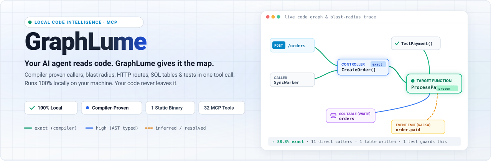
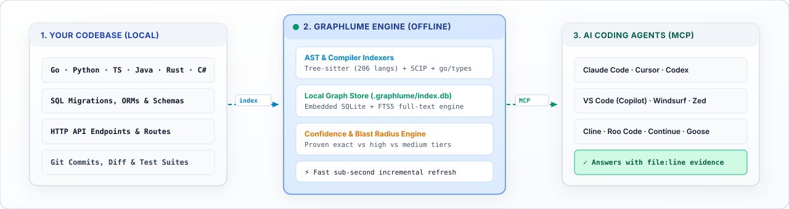

<div align="center">

<a id="top"></a>

<picture>
  <source media="(prefers-color-scheme: dark)" srcset="docs/assets/hero-dark.svg">
  
</picture>

# GraphLume

**The local code knowledge graph and MCP server for AI coding agents.**

Callers, blast radius, routes, database tables and tests in one tool call,<br>
every answer backed by `file:line` evidence and a confidence level.<br>
One Go binary. Runs on your machine. Your code never leaves it.

[](https://github.com/sutrakam/graphlume/actions/workflows/ci.yml)
[](https://github.com/sutrakam/graphlume/releases/latest)
[](https://pkg.go.dev/github.com/sutrakam/graphlume)
[](docs/reference/mcp-tools.md)
[](#languages)
[](LICENSE)

[Quickstart](#quickstart) · [Capabilities](#capabilities) · [GitHub Action](#github-action) · [Accuracy](#why-the-answers-can-be-trusted) · [Security](#security-and-privacy) · [FAQ](#faq) · [Docs](#documentation)

</div>

---

## What is GraphLume?

GraphLume is an open-source, local-first code intelligence engine. It indexes a repository into a code knowledge graph (definitions, calls, imports, HTTP routes, database tables, events, configuration and tests) and serves that graph to AI coding agents over the [Model Context Protocol (MCP)](https://modelcontextprotocol.io), a CLI and a REST API.

Agents such as Claude Code, Cursor, Codex, GitHub Copilot, Windsurf and Gemini CLI use it to answer *"who calls this?"*, *"what breaks if I change it?"* and *"which tests cover it?"* without reading the whole codebase. Each relationship records how it was established (`exact`, `high`, `medium` or `low`) and where it was found, so an agent can tell a compiler-proven caller from a name match.

| Your agent asks | GraphLume answers with |
|---|---|
| *Who calls `UpdateStatus`?* | Every call site with `file:line`, each marked `exact (compiler)`, `high`, `medium` or `low` |
| *What breaks if I change it?* | Direct and indirect dependents, the tests that reach them, a risk score, and what it **could not** see |
| *Where do I start on the webhook retry bug?* | A bounded context pack: the few files, symbols, tests and tables that matter |
| *Which service calls this endpoint?* | Cross-repository links between HTTP clients and routes, and between services that share tables |
| *Is this pull request safe to merge?* | A PR blast-radius report, architecture and policy checks, and SARIF for GitHub code scanning |

<div align="center">
<picture>
  <source media="(prefers-color-scheme: dark)" srcset="docs/assets/architecture-dark.svg">
  
</picture>
</div>

## Quickstart

### Requirements

- macOS (Intel or Apple silicon), Linux (x86-64 or ARM64) or Windows (x86-64)
- Git, if you want history-based answers (owners, hotspots, PR impact)
- Go 1.26 or later only if you install with `go install`

### 1. Install

```bash
# macOS and Linux
curl -fsSL https://raw.githubusercontent.com/sutrakam/graphlume/main/install.sh | sh

# Go toolchain
go install github.com/sutrakam/graphlume/cmd/graphlume@latest
```

```powershell
# Windows (PowerShell)
irm https://raw.githubusercontent.com/sutrakam/graphlume/main/install.ps1 | iex
```

```bash
# Container
docker run --rm -v "$PWD:/workspace" ghcr.io/sutrakam/graphlume index
```

Pinned versions, checksum verification and offline installs are covered in the [installation guide](docs/getting-started/installation.md).

### 2. Index the project and connect your agents

```bash
cd your-project
graphlume init --all
```

This builds the index in `.graphlume/index.db`, registers the MCP server with every coding agent it finds on the machine, and adds a short guidance block to `AGENTS.md` so the agent uses GraphLume before it falls back to grep. Optional compiler indexers are offered one at a time, with what each downloads and from where, and nothing is installed without your confirmation.

### 3. Ask your agent

> *What breaks if I change `<your function>`?*

The index refreshes itself as files change.

<details>
<summary>Let your agent install it</summary>

Paste this into any terminal-based coding agent:

```text
Read https://raw.githubusercontent.com/sutrakam/graphlume/main/llms-install.md and set up GraphLume for this repository.
```
</details>

## See it answer

Real output from this repository. Every caller below was proved by the Go type checker:

```console
$ graphlume callers RegisterProject
10 caller(s) of RegisterProject (internal/multirepo/registry.go:247) are recorded, at 13 call sites.

KIND   SYMBOL                                 EVIDENCE                                 CONFIDENCE
CALLS  TestCleanCommandDefault                internal/cli/clean_test.go:29            exact (compiler)
CALLS  newInitCmd                             internal/cli/init.go:106                 exact (compiler)
CALLS  TestWorkspaceListCLI                   internal/cli/workspace_test.go:80        exact (compiler)
CALLS  TestProjectsActionIsScopedUnlessLocal  internal/mcp/discovery_scope_test.go:31  exact (compiler)
CALLS  TestConcurrentRegistryMutations        internal/multirepo/registry_test.go:107  exact (compiler)
...
```

The blast radius, as an agent receives it over MCP. It leads with the verdict and then states the limits of what it knows:

```text
CanonicalPath (internal/multirepo/registry.go:69): 11 direct, 45 indirect.
Risk moderate or higher (59/100; the analysis was cut at depth 3).

note:  public_api (+25): The target is exported. Callers outside this repository are not indexed.
note:  observed_tests (-10): 38 of the impacted symbols are test code, so a change here is at least partly guarded.
note:  NOT VISIBLE (unexpanded_frontier): symbols beyond depth 3 are affected-status unknown, not unaffected.
note:  This is a LOWER BOUND. Do not treat an empty result as proof that nothing breaks.
```

## Capabilities

**For coding agents.** 32 MCP tools in four profiles, so you decide how much schema enters the agent's context: `minimal` (8 tools, the default), `standard`, `full`, or `compact`, a single front-door tool of about 680 tokens.

- `context`: the minimum files, symbols and tests for a task
- `callers`, `references`, `impact`, `tests`
- `explore`: definition, callers, callees, routes and tests in one call
- `trace`: how A reaches B, through waypoints you name
- `plan`, `rename`, `patch`: plan and dry-run a change before writing it
- `endpoints`, `tables`, `config`, `deadcode`, `hotspots`, `owners`
- `estate`: links, callers and impact across several repositories

**For pull requests.** `graphlume pr-impact` maps changed lines to symbols, callers and tests. `graphlume ci check` and `graphlume policy check` enforce blast-radius limits, dependency-cycle rules and architecture boundaries from `.graphlume.yml`, with SARIF 2.1.0 output and a non-zero exit on violation.

**For microservices and many repositories.** `graphlume system` builds one graph across repositories, linking HTTP clients to the routes they call and services to the tables they share. `graphlume system contracts` flags calls whose method or path no longer matches any route.

**For teams.** `graphlume serve --http` shares one index over MCP Streamable HTTP and a REST API with an OpenAPI 3.1 description, with named, scoped and expiring tokens, `viewer` / `editor` / `admin` roles and an audit log. `graphlume index pull` installs the index CI built for your commit.

**For understanding a codebase.** `graphlume tour` gives a reading order from the entry points. `graphlume communities` groups files into modules and ranks the most central ones. `graphlume hotspots`, `owners` and `bus-factor` show where change and knowledge concentrate.

**For token budgets.** `graphlume pack` exports a repository as one XML, Markdown or JSON prompt with secrets redacted, `minimize-diff` strips diff noise, and every answer is bounded and paged, so a function with 5,000 callers never floods the context.

## GitHub Action

GraphLume ships as a GitHub Action that indexes the repository, reports the blast radius of a pull request as a sticky comment, uploads SARIF to code scanning and fails the check on architecture violations or high-severity blind spots.

```yaml
name: GraphLume
on:
  pull_request:
    branches: [main]

permissions:
  contents: read
  pull-requests: write
  security-events: write

jobs:
  change-safety:
    runs-on: ubuntu-latest
    steps:
      - uses: actions/checkout@v7
        with:
          fetch-depth: 0
      - uses: sutrakam/graphlume@v1
        with:
          fail-on: high
      - uses: github/codeql-action/upload-sarif@v4
        if: always()
        with:
          sarif_file: graphlume-out/graphlume.sarif
          category: graphlume
```

| Input | Default | Purpose |
|---|---|---|
| `version` | `v1.0.0` | GraphLume release to run (`latest` is accepted) |
| `fail-on` | `high` | Lowest severity that fails the check: `high`, `medium`, `low` or `none` |
| `accuracy` | `auto` | `auto` imports compiler facts first; `fast` uses heuristic edges only |
| `comment-pr` | `true` | Post or update the sticky pull request report |
| `upload-index` | `false` | Upload the verified index as an artifact for `graphlume index pull` |

All inputs and outputs are listed in [`action.yml`](action.yml).

## Why the answers can be trusted

> [!IMPORTANT]
> **Every relationship carries a confidence level and its evidence.** `exact` means a compiler proved it (the Go type checker, or a SCIP indexer for TypeScript, Java, Python and others), and nothing else may claim it. This is enforced in the code, in the database schema and at commit time. `high`, `medium` and `low` are graded heuristics. When a name could mean too many things, GraphLume refuses to guess and says so.

An empty answer is reported as "nothing found", never "nothing breaks". Truncated traversals, unresolved references and files that could not be parsed are named in the answer, so the agent knows when to look further.

Measured by hand on 14 open-source projects the work was not tuned on:

| What was checked | Result |
|---|---|
| Edges marked `high` that are correct | **405 / 420 (96%)** |
| Calls in the sampled files that were found | **450 / 529 (85%)** |
| Definitions found in 14 languages | **3,081 / 3,106**, with 12 spurious |
| Definitions in 36 further languages | **97% precision**, 85% recall |
| Kubernetes (16,486 files, 274,838 symbols) | Indexed in 260 s; references resolved in 57 s |

Methods and limits: [BENCHMARKS.md](BENCHMARKS.md) and [docs/accuracy.md](docs/accuracy.md).

## How it compares

| | grep / ripgrep | Embeddings / vector RAG | Name-matching code graphs | **GraphLume** |
|---|:---:|:---:|:---:|:---:|
| Finds callers through interfaces and methods | No | No | By name only | Compiler-resolved |
| Says how sure it is, per answer | No | No | No | `exact` / `high` / `medium` / `low` |
| Refuses ambiguous matches instead of guessing | n/a | No | No | Yes |
| Blast radius with the tests that cover it | No | No | Partial | Yes |
| HTTP routes, database tables and events in the graph | No | No | Partial | Yes |
| Links services across repositories | No | No | No | Yes |
| Keeps up with edits without a full re-index | Yes | No | Partial | Content-hash refresh |
| Runs fully offline, no API keys | Yes | Usually not | Yes | Yes |

Why a graph instead of embeddings: [docs/WHY_NOT_VECTOR_RAG.md](docs/WHY_NOT_VECTOR_RAG.md).

## Supported agents

`graphlume init --all` (or `graphlume setup`) detects and configures 40+ agents and editors, including Claude Code, Claude Desktop, Cursor, Codex CLI, VS Code with GitHub Copilot, Windsurf, Zed, Gemini CLI, JetBrains AI and Junie, Cline, Roo Code, Kilo Code, Continue, Goose, Amp, Warp, Kiro, OpenCode, Qwen Code, Amazon Q and Augment. Use `--local` to write project-scoped configuration only.

<details>
<summary>Manual configuration</summary>

**Claude Code**
```bash
claude mcp add graphlume -- graphlume serve
```

**Cursor, Windsurf, Gemini CLI and other `mcp.json` clients**
```json
{
  "mcpServers": {
    "graphlume": { "command": "graphlume", "args": ["serve"] }
  }
}
```

**Codex CLI** (`~/.codex/config.toml`)
```toml
[mcp_servers.graphlume]
command = "graphlume"
args = ["serve"]
```

**Scripts and shell-first agents**: every command accepts `--json`.

**REST**: `graphlume serve --http 127.0.0.1:7788` serves `/api/v1/tools/{name}` and `/api/v1/openapi.json`. See [protocols](docs/guides/protocols.md).
</details>

## Languages

206 languages in four tiers, so you know what you get for each:

| Tier | Count | What you get |
|---|---:|---|
| **Typed** | 12 | Definitions, imports and receiver-aware references that reach `high`, and `exact` with a compiler indexer: Go, TypeScript, JavaScript, Python, Java, Kotlin, C#, C++, Rust, Ruby, PHP, Scala |
| **Resolved** | 35 | Definitions and references bound across files: Swift, Dart, Elixir, Lua, Bash, Zig, Haskell, Solidity, Vue, Svelte and more |
| **Parsed** | 68 | Definitions and search |
| **Text only** | 91 | Full-text search |

Go is type-checked out of the box. `graphlume indexers install` adds SCIP compiler indexers for other languages, and `graphlume languages` prints the full list.

## Security and privacy

- **No network.** Indexing and queries make no network requests: no telemetry, no cloud service, no API keys.
- **Secrets are redacted** (`.env*` files, keys and credential patterns) before anything is stored or returned.
- **Safe on untrusted repositories.** A repository's own `.graphlume.yml` can only choose what to index; running a compiler indexer is allowed only by your user configuration. Reads are confined to the repository root, so symlink escapes, `../` paths and FIFOs are refused.
- **Verifiable releases.** Every release ships SHA-256 checksums signed with Sigstore, build-provenance attestations and CycloneDX SBOMs. See [verifying a release](docs/operations/verifying-a-release.md).

Report a vulnerability privately as described in [SECURITY.md](.github/SECURITY.md). Details: [security model](docs/security.md).

## Uninstall

```bash
graphlume clean --dry-run  # show what would be removed
graphlume clean            # this project: index, git hooks, guidance blocks, project MCP configuration
graphlume uninstall        # everything: every project, every agent configuration, ~/.graphlume
```

## FAQ

**What is GraphLume used for?**
It gives AI coding agents an accurate map of a codebase: who calls a function, what a change affects, which tests cover it, and how services connect through HTTP routes and shared database tables.

**Does GraphLume send my code anywhere?**
No. It runs on your machine, stores its index in `.graphlume/` inside the project, and makes no network requests while indexing or answering.

**Which AI coding agents does it work with?**
Any agent that supports MCP, including Claude Code, Cursor, Codex CLI, GitHub Copilot in VS Code, Windsurf, Zed and Gemini CLI. Agents without MCP can call the CLI with `--json` or the REST API.

**How is it different from vector search or RAG over code?**
Embeddings return text that looks similar. GraphLume returns relationships that exist, resolved by syntax and, where available, a compiler, with a confidence level on each one.

**Which languages does it support?**
206 languages in four tiers. Go, TypeScript, JavaScript, Python, Java, Kotlin, C#, C++, Rust, Ruby, PHP and Scala get the deepest analysis.

**Is it free?**
Yes. GraphLume is open source under the Apache License 2.0.

## Documentation

| | |
|---|---|
| **Start** | [Installation](docs/getting-started/installation.md) · [Quickstart](docs/getting-started/quickstart.md) · [Agent integration](docs/getting-started/agent-integration.md) |
| **Use** | [CLI reference](docs/CLI.md) · [MCP tools](docs/reference/mcp-tools.md) · [HTTP, REST and team servers](docs/guides/protocols.md) · [User guide](docs/USER_GUIDE.md) |
| **Trust** | [Benchmarks](BENCHMARKS.md) · [Accuracy](docs/accuracy.md) · [Security](docs/security.md) · [Verifying a release](docs/operations/verifying-a-release.md) |
| **Build** | [Architecture](docs/architecture.md) · [Contributing](.github/CONTRIBUTING.md) · [Changelog](CHANGELOG.md) |

## Contributing and support

Bug reports and feature requests go through [GitHub Issues](https://github.com/sutrakam/graphlume/issues). Read the [contributing guide](.github/CONTRIBUTING.md) and the [code of conduct](.github/CODE_OF_CONDUCT.md) before opening a pull request. GraphLume follows [Semantic Versioning](https://semver.org); changes are recorded in the [changelog](CHANGELOG.md).

## License

Apache License 2.0. See [LICENSE](LICENSE) and [NOTICE](NOTICE). Third-party components are listed in [THIRD_PARTY.md](THIRD_PARTY.md).

---

<div align="center">

GraphLume is built by **[Sutrakam](https://github.com/sutrakam)**. *Concise tools. Exact work.*

[Back to top](#top)

</div>
